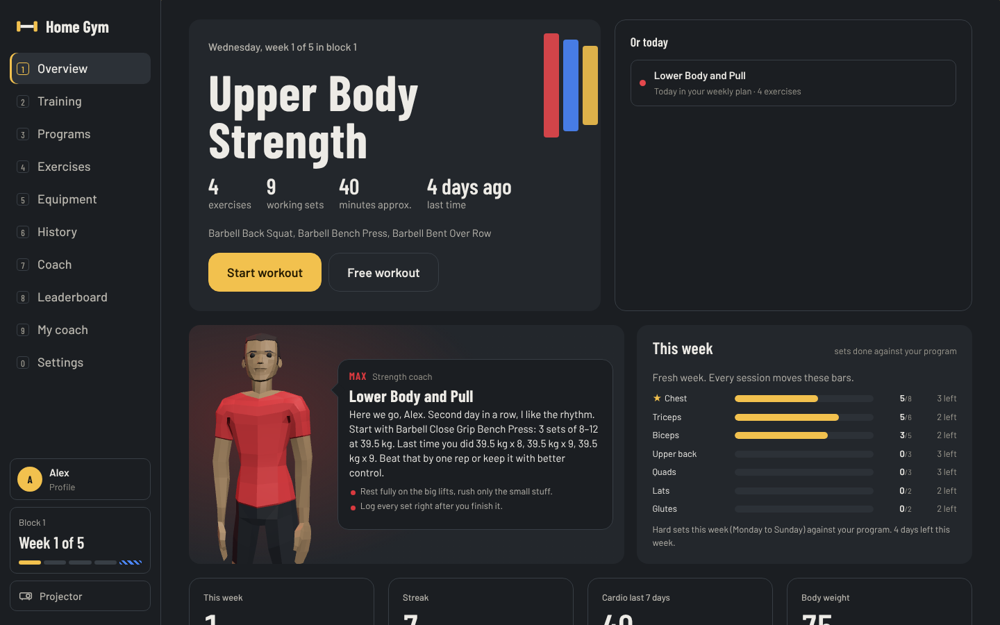
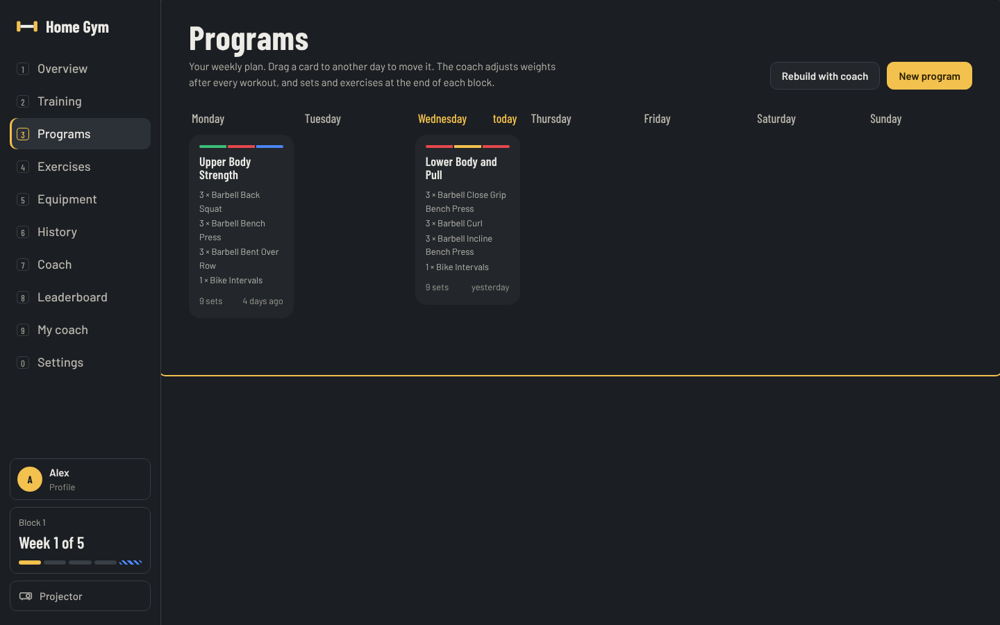
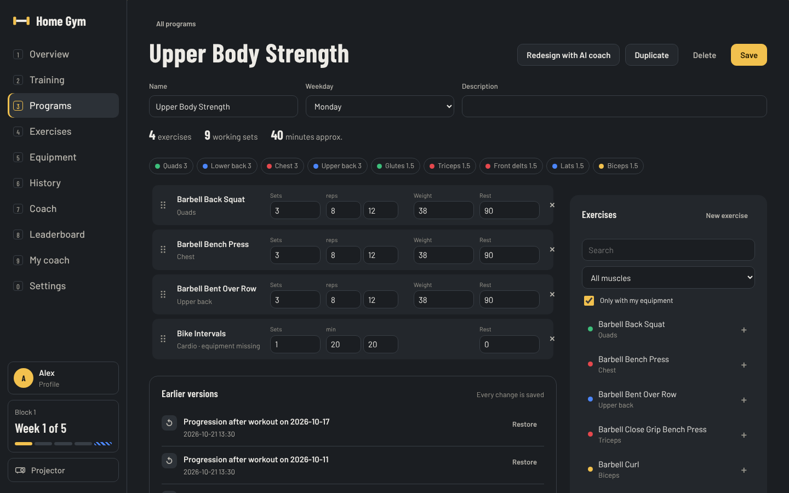
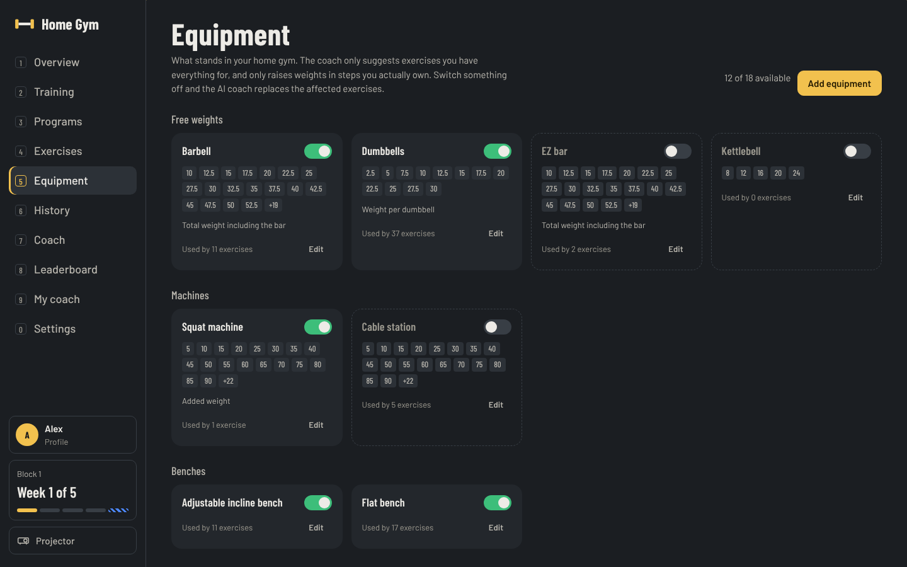
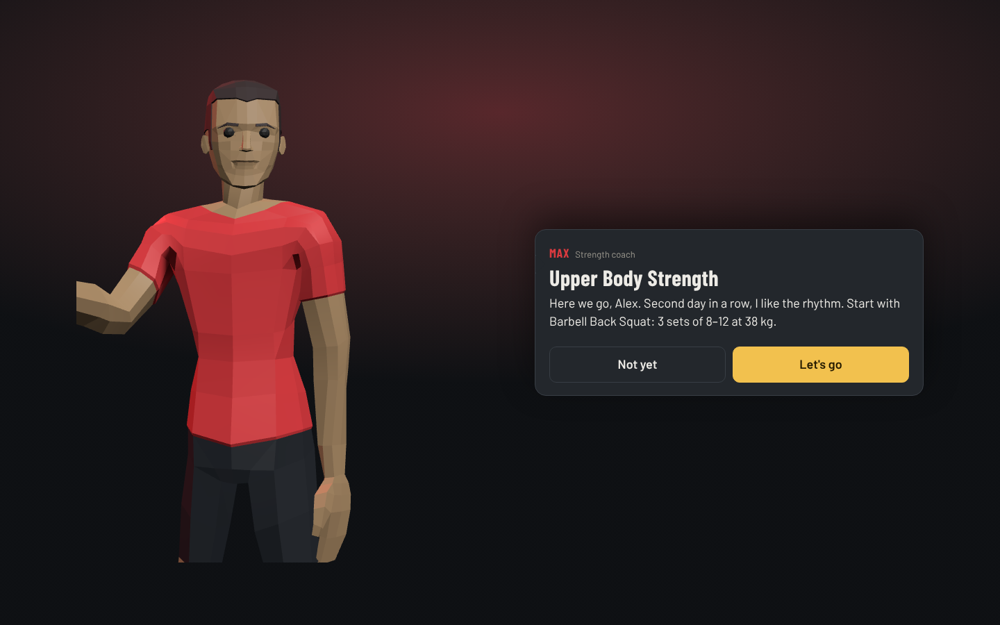
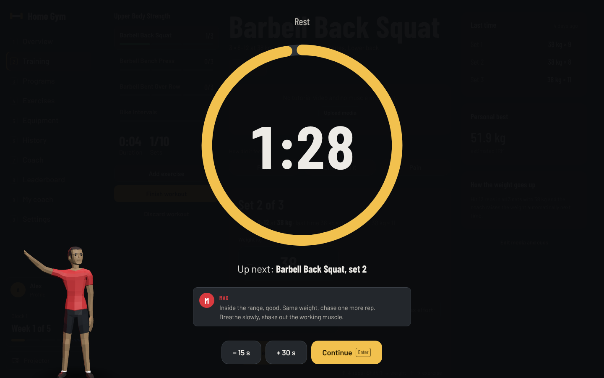
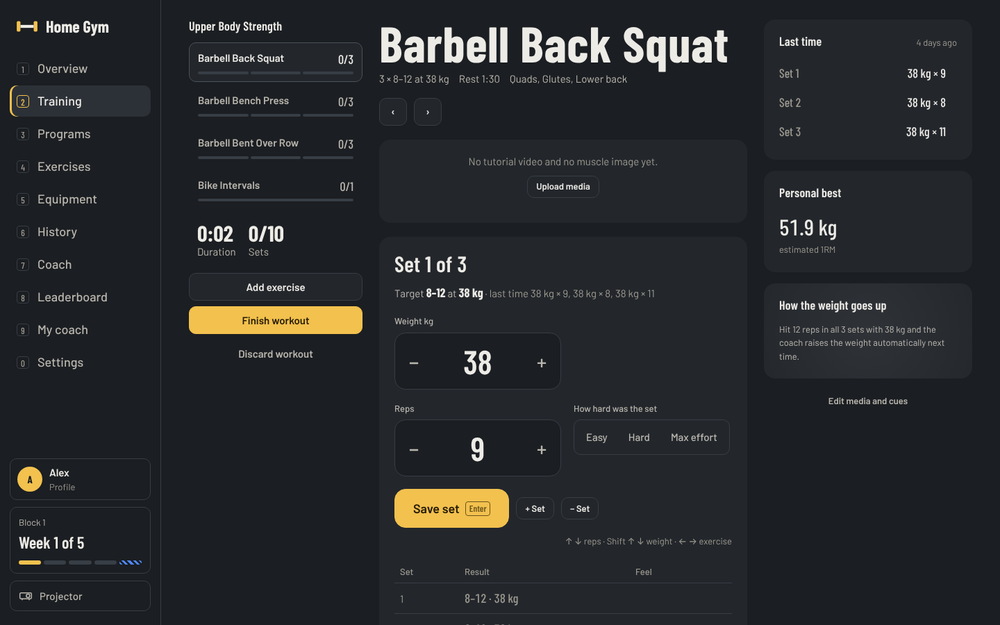
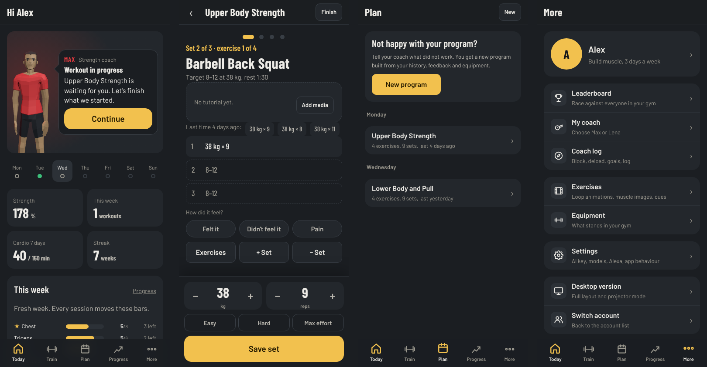
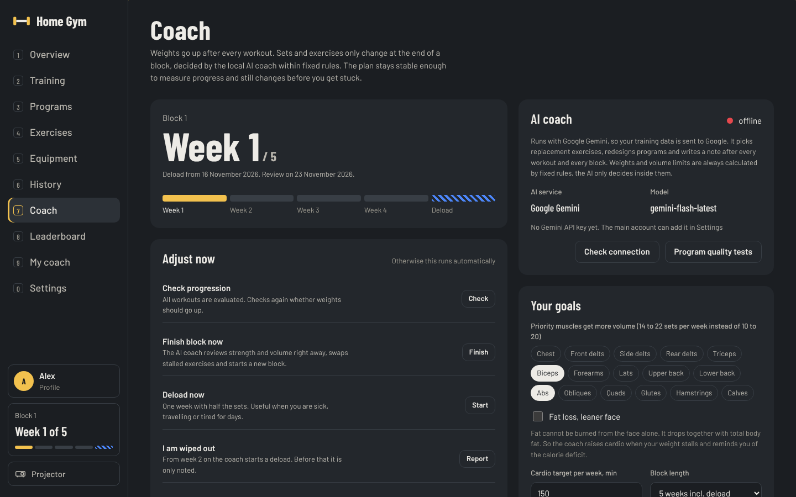
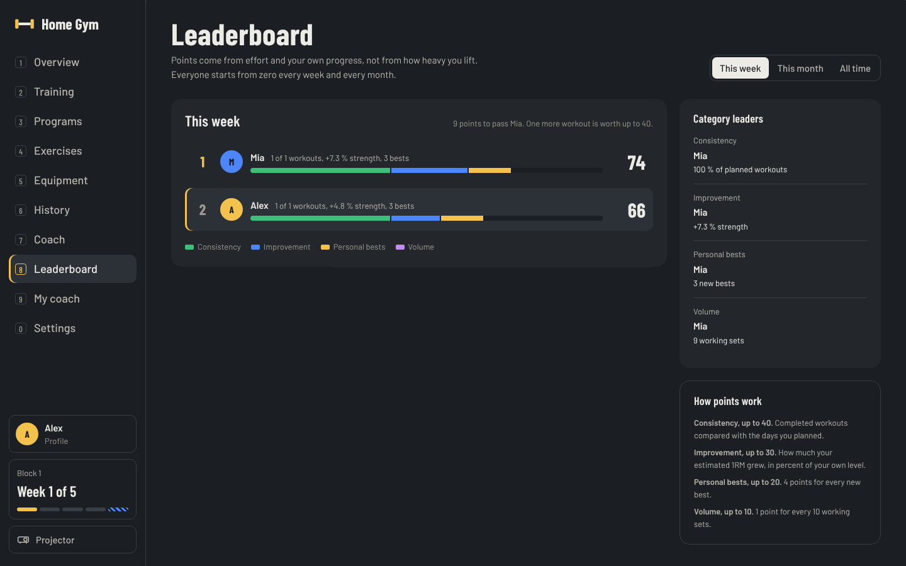

# Home Gym: a self hosted AI workout coach for your home gym

**English** · [Deutsch](README.de.md)

[](https://github.com/kheirisaleh/homegym/actions/workflows/ci.yml)
[](LICENSE)


> **You have a server at home and a gym in your basement? This project was built for you.**
> Home Gym is a training app that runs on your own machine, knows exactly which dumbbells, plates and machines
> you own, writes your program from that, and gets smarter after every workout. You can even ask Alexa how your
> training is going.



---

## The story

It started with a simple problem. A small home gym: an adjustable bench, a barbell, dumbbells that go up in
2.5 kg steps, a pull up bar and a bike. Every app we tried assumed a commercial gym. They suggested cable
crossovers we did not have, told us to add 1 kg when the next dumbbell was 2.5 kg heavier, and kept our data on
someone else's server.

So we built the coach we wanted:

* **It only plans with what you own.** Add your equipment once, including the exact weights. The coach never
  suggests an exercise you cannot do, and it raises weights only in steps you can actually load.
* **It plans from your data.** Your goal, your experience, the muscles you care about, the days you can train, and
  later every set you log. Nothing is a generic template.
* **It lives at home.** One Docker container on your home server, a SQLite file, and your phone on the same Wi-Fi
  (or Tailscale when you are away). Your training history stays on your hardware.
* **It talks to you.** A 3D coach briefs you before a workout, demonstrates the first exercise, cheers during
  rest and sums up what changes next time. At breakfast you can ask Alexa how the week is going.

If that sounds like your setup, keep reading.

## What it does

### A program that fits your equipment and your body

On first start everyone in the household creates a profile in a short onboarding: name, body, experience, goal,
the muscles that matter most (picked on a rotating 3D body), how often you can train and which coach you want.
The AI coach then writes the first program from that profile and your equipment list.

| Plan the week | Edit any day |
| --- | --- |
|  |  |

### Your equipment, your weight steps

Every piece of equipment has an on and off switch, a photo and the weights you own (`2.5..30/2.5` creates a
whole dumbbell rack in one line). Switch something off and the AI coach replaces every exercise that needed it.



### A coach that briefs you, shows you and cheers

Before a workout the coach walks in, explains today's plan with numbers from your last session and demonstrates
the movement pattern of the first exercise (squat, hinge, press, row, curl and more). During rest it gives short
technique tips and counts you back in.

| Workout brief | Rest timer with tips |
| --- | --- |
|  |  |

### Logging made for sweaty hands

Big steppers, the next weight already filled in, keyboard shortcuts on a laptop or projector, and one tap on last
time's numbers to repeat them. Personal bests are detected live.



### On the phone

Install it to the home screen from Safari or Chrome. It is a full workout app with a focus mode, swipe between
exercises and a dock for one handed logging.



### It adapts, carefully

The rules are written down with sources in [docs/COACH_LOGIC.md](docs/COACH_LOGIC.md). In short:

* **After every workout** double progression: reach the top of the rep range in all sets and the weight goes up
  to the next step you own. Fall short twice and it goes back one step.
* **Every 4 to 6 weeks** a block review: sets per muscle move toward 10 to 20 per week (more for priority
  muscles), and at most two stalled exercises are swapped.
* **Deload weeks** at the end of each block, or earlier when two workouts in a row were clearly weaker.
* **Every change is logged and can be undone.** The AI only decides inside limits that fixed rules calculate.



### Ask Alexa

Link the included skill and ask:

* "Alexa, ask **home coach** how my training is going." She asks who you are and answers with your
  week: workouts done out of planned, your leaderboard points, whether today's workout is done, and the last
  message from your coach.
* "Alexa, ask home coach for the **daily report**." Who trained today and how many points everyone earned.

German works too: "Alexa, frag **Haus Trainer**, wie mein Training läuft." Setup: [docs/ALEXA.md](docs/ALEXA.md).

### And also

* **Several people, one gym.** Profiles without passwords, a weekly leaderboard that scores effort and personal
  progress, not raw weight.
* **History and progress.** Calendar, workout list, estimated one rep max per exercise, strength index, body
  weight with a 7 day average.
* **Projector mode.** Press `P` and the workout screen scales for a TV or projector on the gym wall.
* **Own media.** Upload a looping GIF or video and a muscle image for any exercise, or let it find a short
  YouTube clip and loop just the important seconds.
* **Private cycle tracking** for female profiles: period mode adjusts that day's workout, symptoms and phases are
  shown on a PIN protected health page that nobody else can open.
* **Nutrition from your pantry** (optional): see below.



## Pairs well with: Pantry

Home Gym can read what you actually ate from **[kheirisaleh/pantry](https://github.com/kheirisaleh/pantry)**, a
self hosted kitchen and pantry app by the same author. When both run at home, the coach sees calories and protein
of the last 7 days and uses them in its notes and reviews. Turn it on under Settings, "Pantry link". The pantry
calls `POST /api/integrations/pantry` whenever a day is logged.

## Quick start

You need a machine that runs Docker (a NAS, a mini PC, a Raspberry Pi 5, an old laptop) and optionally a Gemini
API key or a local Ollama.

```bash
git clone https://github.com/kheirisaleh/homegym.git
cd homegym
echo "GEMINI_API_KEY=your-key" > .env        # optional, the app works without AI
docker compose up -d --build
```

Open `http://<your-server>:8090` on a laptop or `http://<your-server>:8090/m` on the phone. The first profile you
create becomes the main account that can open the server settings.

**No cloud AI wanted?** Set `AI_PROVIDER=ollama` and `OLLAMA_URL` in `docker-compose.yml`. Logging, weight
progression, deloads and the leaderboard work without any AI at all; only program writing, exercise swaps and the
coach's notes need it.

### Configuration

All settings can be changed in the app (Settings, protected by an admin PIN) or as environment variables:

| Variable | Default | Meaning |
| --- | --- | --- |
| `AI_PROVIDER` | `gemini` | `gemini` or `ollama` |
| `GEMINI_API_KEY` | | key from Google AI Studio |
| `GEMINI_MODEL` | `gemini-flash-latest` | model used by the coach |
| `OLLAMA_URL`, `OLLAMA_MODEL` | `http://ollama:11434`, `qwen2.5:7b-instruct` | local model |
| `ALEXA_SKILL_ID` | | id of your Alexa skill |
| `PANTRY_ENABLED`, `PANTRY_URL`, `PANTRY_TOKEN` | off | nutrition link |
| `AUTO_VIDEO` | `1` | find short exercise videos automatically |
| `TZ` | | your time zone, used for weeks and reports |

### Your data

| Path | Content |
| --- | --- |
| `data/workout.db` | SQLite database with everything |
| `data/media/` | uploaded GIFs, videos, muscle images, equipment photos |
| `data/quality/` | reports of the program quality tests |

Back up the `data` folder and you have backed up everything.

## For researchers and tinkerers

This repository is meant to be read, not only run.

* **Transparent coaching rules** with references: [docs/COACH_LOGIC.md](docs/COACH_LOGIC.md).
* **Onboarding questions and why they are asked**: [docs/ONBOARDING.md](docs/ONBOARDING.md).
* **Program quality tests**: open `/quality` or run `docker exec workout-tracker python quality.py`. Five test personas get a program from
  the AI; each program is checked against the rules (volume per muscle, priority muscles, equipment, difficulty,
  time, cardio, balance) and reviewed by the AI as a second opinion.
* **Open data model**: one SQLite file, readable with any tool. Every coach decision is stored in `coach_log`
  with the program version before the change.
* **Frontend architecture**: [docs/FRONTEND.md](docs/FRONTEND.md).
* **Cite it** with the metadata in [CITATION.cff](CITATION.cff) (GitHub shows a "Cite this repository" button).

### Architecture in one picture

```
 Phone / Laptop / Projector          Alexa                  Pantry (optional)
          │                            │                         │
          ▼                            ▼                         ▼
 ┌──────────────────────────── Docker container ─────────────────────────────┐
 │  React 19 + TypeScript app (app/web)                                      │
 │  FastAPI: routes/ (programs, sessions, coach, users, ...), alexa.py       │
 │  engine.py (progression, blocks, deloads)   architect.py (program writer) │
 │  ai.py (Gemini or Ollama)                   SQLite in /data               │
 └───────────────────────────────────────────────────────────────────────────┘
```

### Development

```bash
pip install -r requirements.txt -r requirements-dev.txt
ruff check . && pytest                         # backend

cd frontend && npm ci
npm run dev                                     # http://localhost:5173, proxies the API on :8000
npm run typecheck && npm run lint && npm test   # static checks and unit tests
npm run build && npx playwright test            # end to end tests on a throw away database
```

Start the API for `npm run dev` with `cd app && BACKGROUND_WORKERS=0 uvicorn main:app --reload`.
`frontend/lab/coach.html` shows the 3D coach alone for tuning moves. GitHub Actions runs every check on each pull
request. See [CONTRIBUTING.md](CONTRIBUTING.md).

### Keyboard

* `1` to `9` switch sections (`0` settings, `H` health), `P` projector mode
* During a workout: `Enter` saves the set, `↑ ↓` reps, `Shift ↑ ↓` weight, `← →` switch exercise

## FAQ

**Do I need a powerful server?** No. The container is limited to 384 MB of memory and idles near zero CPU.

**Does it work without internet?** Yes, with Ollama as the AI provider, or with no AI at all.

**Is my data sent anywhere?** Only when you use Gemini: the coach sends anonymous training numbers to write
programs and notes. Cycle data never leaves the server, and names or dates are never sent.

**Can my whole family use it?** Yes. Everyone has a profile, their own programs and their own coach.

**Which exercises are included?** A catalog of common home gym exercises with muscles, movement patterns and
equipment. Add your own at any time.

## Credits and license

MIT licensed, see [LICENSE](LICENSE). 3D coach and anatomy models are credited in `app/static/coach/ATTRIBUTION.txt`
and `app/static/models/ATTRIBUTION.txt`. Built by [Saleh Kheiri](https://github.com/kheirisaleh).

*Keywords: self hosted workout tracker, home gym app, AI personal trainer, progressive overload, double
progression, deload, Docker, home server, Raspberry Pi, Alexa skill, Gemini, Ollama, React, FastAPI.*
